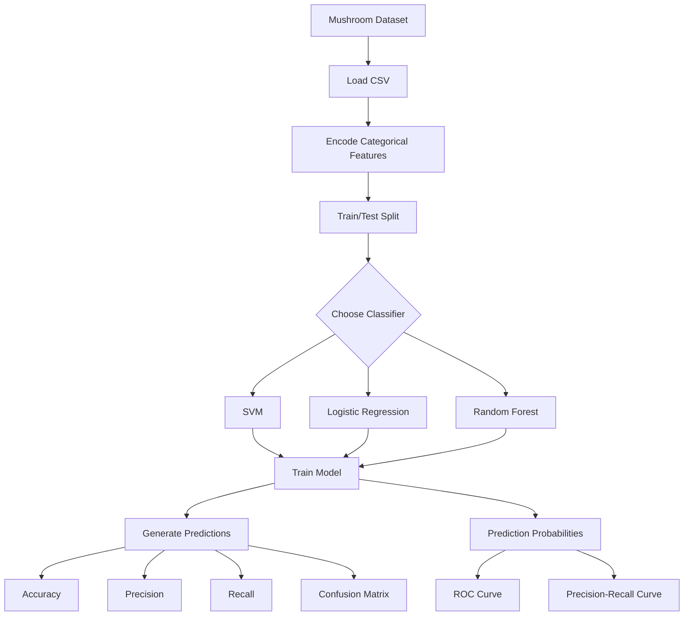
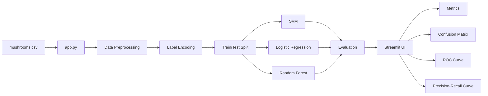
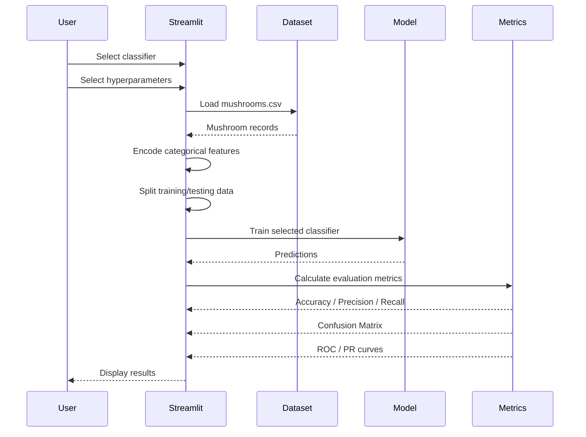
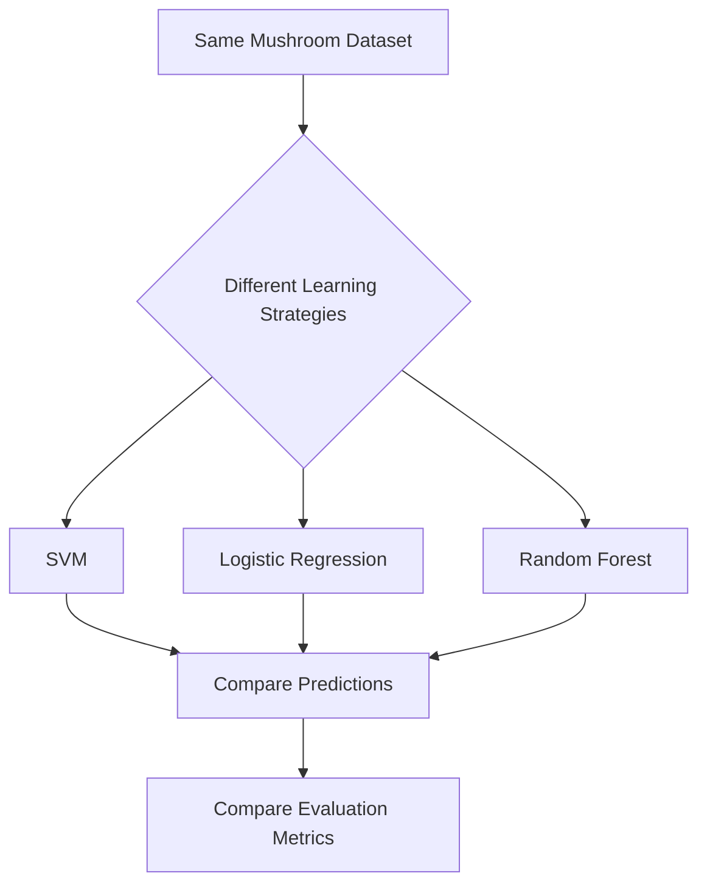

# 🍄 MycoLens

### Interactive Mushroom Classification with Machine Learning

**MycoLens** is an interactive Streamlit machine-learning application that classifies mushrooms into **edible** or **poisonous** categories using multiple supervised learning algorithms.

The application allows users to select a classifier, tune model hyperparameters, train the model, and visualize its performance through **confusion matrices, ROC curves, and precision-recall curves**.

> **Note:** MycoLens is an educational machine-learning project. It should not be used to determine whether a real-world mushroom is safe to consume.

---

## ✨ Features

- 🍄 Binary mushroom classification
- 🤖 Three machine-learning classifiers:
  - Support Vector Machine (SVM)
  - Logistic Regression
  - Random Forest
- 🎛️ Interactive model hyperparameters
- 📊 Accuracy, Precision, and Recall
- 🔲 Confusion Matrix
- 📈 ROC Curve
- 🎯 Precision-Recall Curve
- 🗃️ Optional raw dataset viewer
- ⚡ Streamlit-based interactive interface
- 💻 Runs locally without an external API or database

---

## 🧠 Machine Learning Workflow



---

## 🏗️ Project Architecture



---

# 🤖 Models

## 1. Support Vector Machine

MycoLens uses `SVC` from scikit-learn.

The interface exposes:

| Hyperparameter | Purpose |
|---|---|
| `C` | Controls regularization |
| `kernel` | Selects the kernel function |
| `gamma` | Controls the kernel coefficient |
| `probability` | Enables probability estimates for ROC/PR curves |

Available kernels:

- `rbf`
- `linear`

---

## 2. Logistic Regression

Logistic Regression is used as a linear classification model.

The interface exposes:

| Hyperparameter | Purpose |
|---|---|
| `C` | Controls regularization |
| `max_iter` | Maximum number of optimization iterations |

---

## 3. Random Forest

Random Forest combines multiple decision trees to perform classification.

The interface exposes:

| Hyperparameter | Purpose |
|---|---|
| `n_estimators` | Number of trees |
| `max_depth` | Maximum depth of each tree |
| `bootstrap` | Whether bootstrap samples are used |

Each model is trained independently using the same train/test split so that their evaluation can be compared consistently.

---

# 📊 Evaluation Metrics

MycoLens provides three primary evaluation metrics.

### Accuracy

Measures the proportion of predictions that are correct.

```text
Accuracy = Correct Predictions / Total Predictions
```

### Precision

Measures how many predicted positive cases are actually positive.

```text
Precision = True Positives / (True Positives + False Positives)
```

### Recall

Measures how many actual positive cases were correctly identified.

```text
Recall = True Positives / (True Positives + False Negatives)
```

For a binary classifier, the confusion matrix provides a more detailed view of these outcomes.

---

# 📈 Model Evaluation Visualizations

## Confusion Matrix

The application generates a confusion matrix showing:

```text
                    Predicted
                 Edible  Poisonous
Actual Edible
Actual Poisonous
```

This makes it possible to inspect correct and incorrect classifications for each class.

## ROC Curve

The ROC curve visualizes the relationship between:

- True Positive Rate
- False Positive Rate

The application uses model probability estimates to generate the curve.

## Precision-Recall Curve

The Precision-Recall curve visualizes the relationship between:

- Precision
- Recall

This is particularly useful when examining classification performance across different probability thresholds.

---

# 🖥️ Application Interface

The application provides an interactive Streamlit interface where users can:

- Select a machine-learning classifier
- Configure model hyperparameters
- Select evaluation metrics
- Train the selected model
- View classification results
- View generated evaluation graphs
- Optionally inspect the raw dataset

The interface is designed around the model-training and evaluation workflow described above.

---

# ⚙️ Tech Stack

| Technology | Purpose |
|---|---|
| Python | Core programming language |
| Streamlit | Interactive web application |
| Pandas | Data loading and manipulation |
| Scikit-learn | Machine learning |
| Matplotlib | Visualization |
| CSV | Dataset storage |

---

# 🔄 Data Processing Pipeline



---

# 🚀 Getting Started

## 1. Clone the repository

```bash
git clone https://github.com/charveemasand108/MycoLens.git
cd MycoLens
```

## 2. Install dependencies

```bash
pip3 install streamlit pandas scikit-learn matplotlib
```

Or:

```bash
python3 -m pip install streamlit pandas scikit-learn matplotlib
```

## 3. Run the application

```bash
streamlit run app.py
```

If the `streamlit` command is unavailable:

```bash
python3 -m streamlit run app.py
```

The application will normally be available at:

```text
http://localhost:8501
```

---

# 🎮 How to Use

### Step 1 — Select a classifier

Choose one of:

```text
Support Vector Machine (SVM)
Logistic Regression
Random Forest
```

### Step 2 — Configure the model

Adjust the available hyperparameters in the sidebar.

### Step 3 — Select evaluation plots

Choose any combination of:

```text
Confusion Matrix
ROC Curve
Precision-Recall Curve
```

### Step 4 — Click `Classify`

The selected model is trained using the training data and evaluated on the test data.

### Step 5 — Analyze the results

Review:

- Accuracy
- Precision
- Recall
- Confusion Matrix
- ROC Curve
- Precision-Recall Curve

---

# 🔬 Why Compare Multiple Models?

Different classifiers learn decision boundaries in different ways.



### SVM

Finds a decision boundary that separates classes while maximizing the margin between them.

### Logistic Regression

Models the probability of a class using a linear decision function.

### Random Forest

Combines predictions from multiple decision trees to produce a final classification.

Because these models use different learning strategies, their predictions and evaluation results can differ.

---

# 📌 Reproducibility

The train/test split uses a fixed `random_state`, which makes the split reproducible when the same dataset and code are used.

The Random Forest model also uses a fixed random state.

This helps make experiments more consistent when comparing model configurations.

---

# 🔐 Privacy & Security

MycoLens does not require:

- API keys
- passwords
- external databases
- user accounts
- cloud credentials

The application reads the local `mushrooms.csv` dataset and performs the machine-learning workflow locally.

**Do not add API keys, passwords, tokens, or other secrets to the repository.**

---

# 💰 Cost

MycoLens is designed to run locally using open-source Python libraries.

There is no paid API or external service required by the application.

Running:

```bash
streamlit run app.py
```

starts a local Streamlit server on your computer.

---

# 🎯 Learning Objectives

This project demonstrates practical understanding of:

- Binary classification
- Data preprocessing
- Categorical feature encoding
- Train/test splitting
- Supervised learning
- SVM
- Logistic Regression
- Random Forest
- Hyperparameter tuning
- Model evaluation
- Confusion matrices
- ROC analysis
- Precision-Recall analysis
- Streamlit application development
- Python-based machine-learning workflows

---

# 🧪 Experimentation Ideas

Future experiments can include:

- Comparing different SVM kernels
- Testing different values of `C`
- Changing Random Forest tree counts
- Testing different Random Forest depths
- Comparing bootstrap settings
- Comparing model precision and recall
- Adding additional evaluation metrics
- Adding feature importance visualization for Random Forest
- Adding a model-comparison dashboard
- Adding interactive prediction for individual mushroom feature inputs

---

# 🛠️ Future Improvements

Potential improvements include:

```text
Current
  │
  ├── Multiple classifiers
  ├── Hyperparameter controls
  ├── Evaluation metrics
  └── Interactive plots
        │
        ▼
Future
  ├── Model comparison dashboard
  ├── Feature importance
  ├── Cross-validation
  ├── Prediction form
  ├── Better visual design
  └── Optional deployment
```

---

# 📚 Project Context

MycoLens was developed as a hands-on machine-learning and Streamlit project using a mushroom classification dataset.

The project focuses on understanding the complete workflow from:

```text
Dataset
   ↓
Preprocessing
   ↓
Model Selection
   ↓
Training
   ↓
Prediction
   ↓
Evaluation
   ↓
Visualization
```

---

# ⚠️ Disclaimer

**MycoLens is an educational machine-learning project and is not a food-safety system.**

Never use the predictions of this application to decide whether an unknown mushroom is safe to eat. Real-world mushroom identification requires appropriate expert verification.

---

# 👩‍💻 Author

**Charvee Masand**

GitHub:  
https://github.com/charveemasand108

Project:  
https://github.com/charveemasand108/MycoLens

---

# ⭐ If You Find This Project Useful

Consider giving the repository a ⭐ on GitHub and exploring the code to experiment with different machine-learning models and hyperparameters.
